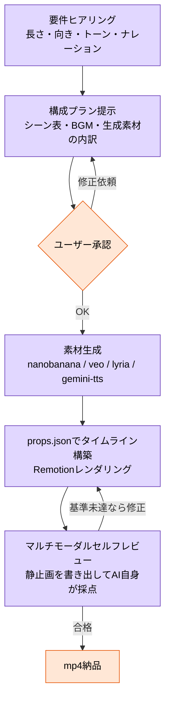

# はじめに

Claude Codeに「こんな動画作って」とお願いすると、構成案の提示から素材生成、動画の合成、セルフレビューまで一気通貫でやってくれる`video-composer`というスキルを作りました！

https://www.skills.sh/danishi/claude-code-config/video-composer

そして本記事の最後に、 **このスキル自身に作らせた「この記事の紹介動画」** を載せています。スキルがどんなアウトプットを出すのか、ぜひ最後まで見ていってください。

# video-composerスキルとは

`video-composer`は、Reactベースの動画作成フレームワーク[Remotion](https://www.remotion.dev/)のタイムライン上に、Googleの生成AIモデルで作った素材を乗せて1本のmp4に仕上げる**オーケストレーター型のスキル**です。

スキル自身はメディアを一切生成せず、私のリポジトリで公開している4つのメディア生成スキルを指揮して、それぞれの成果物を組み立てる役割に徹しています。

| レイヤー | スキル | 使っているモデル |
| --- | --- | --- |
| 画像・背景 | [nanobanana](https://www.skills.sh/danishi/claude-code-config/nanobanana) | Nano Banana Pro / Nano Banana 2 |
| 動画クリップ | [veo](https://www.skills.sh/danishi/claude-code-config/veo) | Veo 3.1（デフォルトはコスパの良いLite） |
| BGM | [lyria](https://www.skills.sh/danishi/claude-code-config/lyria) | Lyria 3 Pro / Lyria 3 Clip |
| ナレーション | [gemini-tts](https://www.skills.sh/danishi/claude-code-config/gemini-tts) | Gemini 3.1 Flash TTS |

インストールはこちら。依存する4スキルも同じリポジトリから入れられます。

```shell
npx skills add https://github.com/danishi/claude-code-config --skill video-composer
```

APIアクセスは`GEMINI_API_KEY`（またはVertex AI）があれば動きます。RemotionがffmpegをバンドルしているのでNode.js 18以上が入っていればOKです。

:::message alert
各スキルが呼び出すモデル（Veo・Lyria・Nano Banana・Gemini TTS）はいずれも**有料のAPI**です。動画1本でも画像・クリップ・音声など複数の素材を生成するため、[Gemini APIの料金](https://ai.google.dev/gemini-api/docs/pricing)や[Vertex AIの料金](https://cloud.google.com/vertex-ai/generative-ai/pricing)を確認の上、コストにはご注意ください。特に動画生成（Veo）は他のモデルより単価が高めです。
:::

# 組み合わせている技術の紹介

## Remotion

https://www.remotion.dev/

Reactのコンポーネントとしてフレームを記述し、プログラマブルに動画をレンダリングできるフレームワークです。
「コードで動画を作れる」ということは、**生成AIが動画編集できる**ということでもあります。タイムラインをJSONデータ（`props.json`）として外出しする設計にしたので、Claude Codeはシーン構成・字幕・トランジション・音声をすべてデータ編集だけでコントロールできます。

```jsonc
{
  "fps": 30, "width": 1920, "height": 1080,
  "bgm": { "src": "audio/bgm.mp3", "volume": 0.22 },
  "scenes": [
    {
      "durationInFrames": 240,
      "media": { "type": "image", "src": "images/scene1.png" },
      "kenBurns": true,
      "captions": [ { "text": "Claude Codeで動画制作", "fromFrame": 0, "toFrame": 230 } ],
      "voiceover": { "src": "audio/vo1.wav" },
      "transitionToNext": { "type": "fade", "durationInFrames": 18 }
    }
  ]
}
```

:::message
Remotionは無料で使えますが、企業利用では[ライセンス](https://www.remotion.dev/license)の確認が必要なケースがあります。利用前に一読をおすすめします。
:::

## Veo 3.1（動画クリップ生成）

実写さながらの動画クリップを音声付きで生成できるGoogleの動画生成モデルです。スキルではコスト効率の良いVeo 3.1 Liteをデフォルトにしていて、4〜8秒のクリップをシーンの「動き」が欲しい場面に使います。

以前Veo 2を試した記事はこちら。ここから1年ちょっとでネイティブ音声付きまで進化したと考えるとすごい。

https://zenn.dev/iret/articles/veo2-on-vertex-ai

## Lyria 3（BGM生成）

プロンプトから音楽を生成できるモデルです。フル尺の楽曲を作れるLyria 3 Proと、30秒クリップ向けのLyria 3 Clipを用途で使い分けます。

Lyria 2の頃に「Veoと組み合わさることで強力な進化をしそう」と書いていたのですが、まさか自分のスキルで組み合わせることになるとは。

https://zenn.dev/iret/articles/try-music-ai-lyria

## Gemini TTS（ナレーション生成）

30種類のプリビルドボイスから選べて、「落ち着いたトーンで」「明るく元気に」のような自然言語でのスタイル指定ができる音声合成です。日本語ナレーションも自然に読み上げてくれます。

## Nano Banana（画像生成）

静止画シーンの背景やキービジュアルの生成に使います。動画全体でビジュアルの一貫性が出るよう、スキルは同じスタイル指示をプロンプトに使い回すようにしています。静止画にはKen Burnsエフェクト（ゆっくりズーム・パン）をかけて、止め絵でも動画らしさが出るようにしました。

# スキルのワークフロー

このスキルの一番のこだわりは、**いきなり生成を始めない承認ゲート付きのワークフロー**です。動画生成はAPIコストも時間もかかるので、認識がズレたまま走られるのが一番痛い。そこで必ずプラン承認を挟むようにしています。



ポイントを3つ紹介します。

## 1. シーン表ベースのプラン承認

生成前に「シーン番号・秒数・ビジュアル・ナレーション原稿・字幕・トランジション」を一覧表で提示し、ユーザーが明示的にOKするまで一切素材を作りません。プロンプト1往復で全体像をレビューできるので手戻りが激減します。

## 2. BGMの二重再生問題への対処

Veo はネイティブ音声を生成するので、放っておくと**クリップ自体にBGMを入れてくる**ことがあります。タイムライン上ではクリップの音声（環境音やSE）をそのまま活かしたいので、Lyriaで敷いたBGMとクリップ内蔵のBGMが喧嘩してしまう。

そこでveoクリップ生成時は必ずネガティブプロンプトで音楽だけを抑制するようにしました。

環境音・効果音は残しつつ音楽だけを抑える、というのが生成プロンプトレベルの制御でだいたい上手くいきます（生成なので確実ではなく、ダメなら再生成です）。

## 3. マルチモーダルセルフレビュー

レンダリング後、動画からレビュー用の静止画を数枚書き出して、**Claude自身が画像を見ながらルーブリックで採点**します。字幕の見切れ、シーンとナレーションのミスマッチ、ビジュアルの一貫性などをチェックして、基準を満たすまで自律的に修正ループを回します。修正は安い順（`props.json`の編集→素材の再生成）に試すのもポイントです。

# 実際にこの記事の紹介動画を作ってみた

ということで、このスキルに「この記事を紹介する60秒の動画を作って」とお願いしてみました。

私がやったことは、最初の要件回答（60秒・16:9・日本語ナレーション）と、提示されたシーン構成プランの承認だけです。あとは素材生成からレンダリング、セルフレビューまでClaude Codeが勝手に進めて、mp4が納品されました。

できあがった動画がこちらです！

https://www.youtube.com/watch?v=iwNf2OO95Wk

ナレーション・字幕・BGM・映像のすべてが生成AI製です。よくある「AIで動画生成」のような1ショット生成ではなく、構成された「編集済みの動画」が出てきて、イマイチなところは追加の指示で修正できるのもいいところです。

# 感想

AIツールを使うだけでは差が出ない時代、こういう使い方のスキームをどれだけスキルとして持っているかが勝負になると思っています。Remotionのテンプレートを差し替えればブランドトンマナを固定したプロモ動画の量産などもできるはずなので、引き続きブラッシュアップしていきます。

スキルは公開しているので、ぜひ試してみてください！

https://www.skills.sh/danishi/claude-code-config/video-composer
